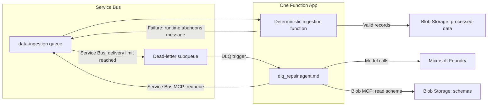

# Azure Functions Hosted Skill: Service Bus DLQ Repair

A Service Bus ingestion sample that adds a Markdown-defined hosted skill to an existing
deterministic function. Valid records are processed without model calls. Malformed records
go to the dead-letter queue (DLQ), where
[`src/dlq_repair.agent.md`](src/dlq_repair.agent.md) defines the trigger and repair instructions.
Both functions run in the same Function App.

## What it does

- **Processes messages:** validates JSON records, normalizes their source, adds ingestion
  metadata, and writes output to Blob Storage.
- **Repairs known format errors:** reads the schema through a Blob MCP connector, corrects
  field names and numeric types, and requeues the message through a Service Bus MCP connector.
- **Validates repaired records:** sends repaired messages through the original ingestion
  function rather than letting the skill write output directly.
- **Shows results:** provides a Microsoft-authenticated web page for individual messages and
  a 1,000-message batch containing five randomly placed malformed records. Counters come from
  persisted output files.

## Prerequisites

- An [Azure subscription](https://azure.microsoft.com/free/) with resource-creation and
  role-assignment permissions.
- [Python 3.13](https://www.python.org/downloads/) and [Node.js/npm](https://nodejs.org/).
- [Azure CLI](https://learn.microsoft.com/cli/azure/install-azure-cli) and
  [Azure Developer CLI (`azd`)](https://learn.microsoft.com/azure/developer/azure-developer-cli/install-azd),
  signed in to the subscription you will use.
- Available Foundry model quota and support for the configured model and preview connectors.
  See [deployment defaults](docs/reference.md#deploy).

The deployment creates a Standard-tier Static Web App and three always-ready, 2-GB Function
instances: one each for HTTP, ingestion, and DLQ repair. These have baseline charges
even when idle. Model calls and other Azure resources incur additional usage charges.
Use synthetic data.

## Quickstart

Run these Bash commands from the sample directory:

```bash
python3.13 -m venv .venv
source .venv/bin/activate
python -m pip install -r src/requirements.txt

azd env new hosted-skill-dlq
azd env set AZURE_SUBSCRIPTION_ID "<subscription-id>"
azd up --no-prompt
```

The deployment creates the Function App, Service Bus queue, storage, Foundry account,
project and model, connector namespace, monitoring, and web page. It uploads the schema
but does not submit messages. No existing Foundry resources or API keys are required.
If your azd environment and subscription are already selected, rerun `azd up --no-prompt`.

### Configure access to the web page

Get the page URL:

```bash
azd env get-value DEMO_URL
```

Open it and sign in with your Microsoft account. In that same browser profile, open
`<DEMO_URL>/.auth/me` and copy `clientPrincipal.userId`. This is the site's user ID,
not your Entra object ID or email.

```bash
azd env set DEMO_OWNER_ID "<userId-from-this-sites-auth-me>"
azd provision --no-prompt
```

Refresh the page after provisioning. Until the owner ID is configured, the API denies
all demo access. The page itself is public; submission and results require the configured
Microsoft identity. See [browser access and authentication](docs/reference.md#browser-demo).

### Send messages and inspect the output

Run one example at a time:

| Action | Input | Expected result |
|---|---|---|
| **Load valid example**, then **Send message** | `record_id` and numeric `value` | One output record; no repair |
| **Load malformed example**, then **Send message** | `recordId` and string `value` | One repaired output record |
| **Send 1,000 records** | Five malformed records at distinct random positions; the other 995 records are valid | 1,000 output records, including all five malformed records recovered |

Each submission gets fresh record IDs. The hosted skill is enabled automatically;
there is no separate repair button. The page shows submitted input beside processed output.
Each batch contains exactly five malformed records.
The chosen positions are saved in the run manifest and do not change on submission retries.
The cap applies to malformed input records, not repair attempts or model calls.
The diagram follows confirmed milestones for every browser-submitted record.
Validation failures highlight the DLQ and hosted-skill branch as **Awaiting recovery**.
Estimated dot movement fills the gap through the DLQ and hosted skill.
The return route updates when ingestion receives a requeued message; **Recovered**
requires a saved output file. Exact DLQ arrival and skill start are not observed.
One Canvas dot represents each message, including all 1,000 messages in a batch.
Dot positions and travel times are not measurements.
Each record's legs animate in order, while different records move concurrently.
**Highlight repair path** emphasizes the exception route during a batch.
Tracking adds Blob writes and status reads; see [tracking costs and limitations](docs/reference.md#message-flow-diagram).
**Click to result** includes HTTP and polling delays; **run to output** measures server-side
run creation through the final Blob write. Model and connector latency still apply to repairs,
even with warm instances.

**Clear results** clears the display, not Azure data. Refresh reconnects to an active run
and starts clean after a completed run. See [browser behavior and timing](docs/reference.md#browser-demo)
for retry, input, and run-limit details.

For the terminal-based producer and output counter, see
[send a batch from the CLI](docs/reference.md#demo-automatic-repair-of-five-malformed-records).

Open Application Insights to inspect ingestion, hosted-skill execution, and tool calls:

```bash
azd monitor --overview
```

Look for `dlq_repair` invocations and `ingestion_completed record_id=...` traces.
The runtime's `[monitor]` extra exports agent, model, and tool spans using the
configured Application Insights connection string. Sensitive-content capture is
off by default. After enabling monitoring on an existing deployment, send a new
malformed message; historical invocations are not backfilled into agent telemetry.
The host and Python worker use OpenTelemetry with
`OTEL_TRACES_SAMPLER=always_on`, and Application Insights ingestion sampling is set
to 100 percent. The worker exports directly to avoid duplicate forwarded logs.
This increases telemetry ingestion costs. Azure portal log streaming is unavailable
in this mode; use Application Insights Logs and the invocation monitor.
Telemetry can still be delayed or fail to arrive; a persisted output file confirms
successful ingestion. A completed 1,000-record batch with five malformed records,
all repaired without retries, should have 1,005 actual main-queue broker request rows:
1,000 successful deliveries and five failed original deliveries, including five
successful repaired redeliveries in the successful count.
In OpenTelemetry these requests are named `ServiceBusProcessor.ProcessMessage`;
filter their `url` by the queue path, as shown in the portal walkthrough.
The Blob connector wraps schema content in base64. A small deterministic
`decode_schema_content` tool unpacks and validates that schema; the native
Markdown skill still repairs the record and requeues it through Service Bus MCP.
The pinned runtime's authenticated MCP clients need a startup compatibility setting:
30-second connection/write/pool timeouts, a 120-second SSE read timeout and a
150-second MCP request deadline. Its five-second HTTP default can drop a delayed
send acknowledgement after the broker already accepted the message. The native
skill uses the runtime's default deadline; the host timeout remains five minutes.
`src/mcp_transport.py` configures the existing clients, not a replacement consumer.
It accesses an internal client field and fails startup if that layout changes;
revalidate it when upgrading the pinned runtime.
The model defaults to GlobalStandard capacity 500 for the 25-malformed cap.
The skill does not override the runtime's model output limit. Capacity allocates throughput, not
prepaid tokens; actual usage is billed. Lower capacity can throttle concurrent
repairs, and a batch's malformed count does not guarantee its completion time.
See the [portal walkthrough](docs/reference.md#show-what-happened-in-the-portal).

When finished, delete the dedicated deployment and its stored data:

```bash
azd down --purge
```

## Run it locally

Install [Azurite](https://learn.microsoft.com/azure/storage/common/storage-use-azurite) and
[Azure Functions Core Tools](https://learn.microsoft.com/azure/azure-functions/functions-run-local).
Prepare the virtual environment above and copy
[`src/local.settings.json.sample`](src/local.settings.json.sample) to `src/local.settings.json`.

Fill in the Service Bus namespace, data-storage URL, Foundry endpoint and deployment,
and the two MCP endpoints from your Azure deployment. Leave `INGESTION_MCP_CLIENT_ID`
empty to use your developer credential. No API key is needed.

```bash
azurite --silent --location .azurite   # terminal A

# terminal B, from the sample directory
source .venv/bin/activate
cd src
func start
```

Azurite supplies local host storage only. Service Bus, data storage, Foundry, and the MCP
connectors still use Azure. Your local identity needs Service Bus Data Receiver permission
for the queue listeners; provisioning already grants the deploying user model, Blob, and
connector access. Local and cloud listeners use the same deployed queues.

This starts the backend locally, not the authenticated Static Web Apps frontend.
Local principal emulation is only appropriate on localhost with synthetic data.
See [local setup and limitations](docs/reference.md#scope).

## How it works



The runtime discovers the skill's Markdown definition. Its front matter registers the
Service Bus DLQ trigger, and its body supplies repair instructions. One connector namespace
exposes separate Blob and Service Bus MCP configurations. Azure calls use managed identities;
there is no handwritten Python repair function or custom Python tool wrapping the connectors.

The web page submits work through an owner-only HTTP producer that sends directly to
Service Bus using the SDK and managed identity. There is no intermediate Storage Queue.
Both Python producers use the native uAMQP transport. The dependency pins select
Service Bus SDK 7.15.0b2 because it fixes uAMQP batch sending with message IDs and
partition keys; the installed stable 7.14.3 release has that regression.
This producer setting does not change the Functions Service Bus trigger or MCP connector.
See the [native build notes](docs/reference.md#message-flow-diagram) for macOS ARM64.
The API returns acceptance after Service Bus acknowledges the messages, not after ingestion
or repair finishes. Sending has a 25-second deadline; failed or interrupted submissions
can be retried with the same run ID, resuming from persisted send progress.
The existing
ingestion function and the DLQ skill scale independently within the same Flex Consumption app.

The queue uses `maxDeliveryCount: 1` to avoid repeated validation failures during the demo.
That also removes ingestion retries for transient failures. This is a sample for known,
repairable input, not production recovery: a normally returned `REPAIR_FAILED` answer
still completes the DLQ message. See [failure settlement and scope](docs/reference.md#scope)
before adapting it for real data.

[Source layout and record format](docs/reference.md#the-sample) |
[Deploy](docs/reference.md#deploy) |
[Browser demo](docs/reference.md#browser-demo) |
[Throughput](docs/reference.md#show-throughput-without-spending-more-tokens) |
[Limitations](docs/reference.md#scope)

## Learn more

- [Hosted skills in Azure Functions](https://learn.microsoft.com/azure/azure-functions/functions-serverless-agents-runtime)
- [Azure Functions Flex Consumption](https://learn.microsoft.com/azure/azure-functions/flex-consumption-plan)
- [Connector Namespace](https://learn.microsoft.com/azure/connector-namespace/connector-namespace-overview)
- [Service Bus dead-letter queues](https://learn.microsoft.com/azure/service-bus-messaging/service-bus-dead-letter-queues)
- [Hosted Skills Expense Processor sample](https://github.com/Azure-Samples/hosted-skills-expense-processor)
