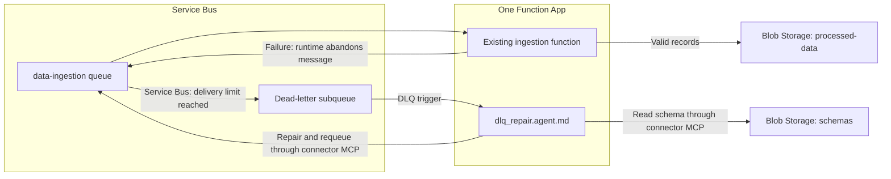

# Deployment and demo reference

See the [README](../README.md) for the quickstart.

The sample uses one Function App and a browser batch of 1,000 records with
five malformed messages at distinct random positions.
The existing function validates, normalizes, and enriches records before writing
them to partitioned Blob Storage. A hosted skill
consumes the DLQ, fixes malformed records, and requeues them.
The ingestion code does not call a model.



## The sample

```text
src/function_app.py          Existing deterministic ingestion + create_function_app()
src/demo_api.py              Owner-only direct Service Bus producer and status endpoints
src/dlq_repair.agent.md      Hosted skill with its own Service Bus DLQ trigger
src/mcp.json                Connector namespace MCP tools
src/record-schema.json      Ingestion contract, also uploaded for the skill to read
samples/messages.json       Valid and malformed examples
scripts/                    Seed schema, send records, count output
web/public/                 Static demo page, no frontend framework or credentials
infra/                      One Function App and its demo resources
azure.yaml                  azd deployment
```

**There is no handwritten Python repair function.** The Hosted Skills runtime
discovers the Markdown file and registers its DLQ trigger. That hosted skill is
the only DLQ consumer.

The ingestion function accepts `record_id`, `source`, and a numeric `value`.
It validates the input, normalizes `" Partner Feed "` to `"partner-feed"`, and
adds `ingested_at` (UTC) and `schema_version`. It writes the result to
`processed-data/partner-feed/2026/10/01/<record_id>.json`.
The date partition uses the message's UTC enqueue date so a retry after midnight
still targets the same file; `ingested_at` records the processing time.

For example, this input:

```json
{"record_id": "valid-record", "source": " Partner Feed ", "value": 21.5}
```

Produces an enriched output like:

```json
{
  "record_id": "valid-record",
  "source": "partner-feed",
  "value": 21.5,
  "ingested_at": "2026-10-01T18:00:00+00:00",
  "schema_version": 1
}
```

The malformed examples use `recordId` and a string value. They fail validation
before transformation. The demo queue sets `maxDeliveryCount: 1`, so Service
Bus moves them to the DLQ after one failed ingestion attempt. This skips
repeated validation failures for a faster demo, but also removes ingestion
retries for transient failures such as a Storage outage. The one-minute message
lock is unchanged; it is not a mandatory delay before dead-lettering.
Repaired records then pass through the same
normalization and enrichment as healthy records.

The skill reads the schema using the Blob connector, fixes the record, and
uses the Service Bus connector to send it back to `data-ingestion`. The
Markdown instructions present five steps: check for a previous repair, read the
schema, fix the format, requeue once, and confirm the result. Connector payload
rules, data preservation, and failure handling remain explicit.
The existing function then writes its output file. One connector namespace exposes two MCP
server configurations, one for Blob Storage and one for Service Bus. Each
configuration contains exactly one connector. The deterministic function uses the Blob SDK;
there are no custom Python tools wrapping either connector.

## Deploy

Requires Python 3.13, Node.js/npm, Azure CLI, and Azure Developer CLI. Use your existing
signed-in sessions and an account with resource creation and role-assignment
permissions. No existing Foundry account, project, or model is required.

```sh
python3.13 -m venv .venv
source .venv/bin/activate
python -m pip install -r src/requirements.txt

azd env new hosted-skill-dlq
azd env set AZURE_SUBSCRIPTION_ID "<subscription-id>"
azd up --no-prompt
```

If your azd environment and subscription are already selected, just rerun
`azd up --no-prompt`.

`azd` discovers the Function App through its `azd-service-name: api` tag.
Do not set `resourceName` to `SERVICE_API_NAME`: the Function App and its
managed identity share that name, making name-based discovery ambiguous.
If provisioning succeeded but publishing could not find the tagged app,
retry publishing with `azd deploy --no-prompt` once the resource is discoverable.

This follows the expense-processor sample's self-contained deployment pattern.
Bicep creates the Foundry account, project, and model, alongside the Function App,
Service Bus, Blob Storage, Application Insights, connector namespace, and a
Standard-tier Static Web App linked to the Function App. It
wires the generated model and MCP endpoints into the app and assigns roles to
the app, connector namespace, and deploying user. The post-provision hook uploads
the schema before app deployment. There are no separate manual role commands.

| Setting | Default |
| --- | --- |
| App and Foundry region | `eastus2` |
| Model | `gpt-5.4`, version `2026-03-05` |
| Model SKU | `GlobalStandard`, capacity 500 |
| Connector namespace region | `westcentralus` |
| Hosted DLQ skill | Enabled; automatically processes messages arriving in the DLQ |
| Always-ready instances | One 2-GB instance each for `http`, `ingest`, and `dlq_repair` |
| Static Web App | Standard tier, East US 2; linked API with Microsoft sign-in |

The HTTP endpoints share one warm instance; the ingestion function
uses a separate scale group. HTTP concurrency is explicitly set to four per
instance so a producer POST and early status checks can run on the same warm
HTTP instance. Python Flex Consumption otherwise defaults to one concurrent
HTTP request per instance. This reduces the need to scale out for overlapping
demo requests; it does not guarantee that every request avoids startup delay.
The ingestion function and DLQ skill each keep their own instance warm. They can still scale out as
needed. These three always-ready instances incur baseline charges even when idle.
Keeping the DLQ skill warm reduces startup delay, not model or connector execution time.

These are real, billable resources. Model capacity is a throughput allocation,
not a token-spend limit; browser batches contain five malformed records, and
the CLI producer also defaults to five. Retries can add repair attempts and model calls.
For the configured model, capacity 500 provides 500 requests and 500,000 tokens
per minute. Each repair needs multiple model calls, so capacity 50 was insufficient
for the 25-malformed test and produced repeated 429 errors. The skill does not
override the runtime's model output limit; the previous configuration used a
2,048-token cap to avoid reserving an unnecessarily large response budget.
GlobalStandard capacity allocates throughput, not prepaid tokens
or a fixed token bill; actual token usage is billed. The malformed input cap
does not guarantee a batch completion time.
Model availability, subscription quota, and preview connector availability still
apply. Override defaults with `AZURE_LOCATION`, `FOUNDRY_MODEL`,
`FOUNDRY_MODEL_VERSION`, `FOUNDRY_MODEL_CAPACITY`, and `CONNECTOR_LOCATION` using
`azd env set` when needed. The Foundry endpoint is a deployment output, not a
required input.

The default operator is the deploying user; `DEVELOPER_PRINCIPAL_ID` can select a
different user. For CI service-principal deployment, adjust the developer-role
principal type in Bicep. The schema hook retries temporary authorization failures
while roles propagate and fails explicitly if access is still unavailable.

## Browser demo

Open the URL from `azd env get-value DEMO_URL`. The page is public, but sending
messages and reading run data require Microsoft sign-in and an exact match for
the site's `userId` against `DEMO_OWNER_ID`. There are no Azure keys in the browser.
Standard-tier Static Web Apps is required for the linked existing Function App
and has a separate charge.

On a new deployment, sign in with your Microsoft account using the page's
sign-in link, then open `<DEMO_URL>/.auth/me` in that same browser profile.
Copy its `userId` and configure the owner:

```sh
azd env set DEMO_OWNER_ID "<userId-from-this-sites-auth-me>"
azd provision --no-prompt
```

This is the site's user identifier, not your Entra object ID or a token.
Until it is configured, all demo API access is denied. Refresh the page after
provisioning. Changing owners requires changing `DEMO_OWNER_ID` and
provisioning again. Recreating the site or deleting/recreating its user can
change that site's user ID, so repeat this step if needed.

The API performs owner authorization rather than relying on a custom SWA role.
During live testing, custom-role results alternated between the assigned role
and the default roles, even after a fresh sign-in, causing intermittent 403s.
The site now requires the standard `authenticated` role, while the backend
checks the Microsoft provider and exact site user ID. Custom role invitations are
not required and do not grant access by themselves.

The `userDetails` display field can be masked even when the provider and user ID
are unchanged. It is not an authorization identifier. Comparing it with an email
caused intermittent 403s for the configured owner. `DEMO_OWNER_EMAIL` is no longer
required or used; existing values can be left in older environments without effect.

For a 10-minute walkthrough:

1. Load the valid example and select **Send message**. Show its confirmed output.
2. Load the malformed example, or change `record_id` to `recordId` and the
   numeric value to a string. Send again. The new record ID prevents duplicate
   detection or an old output file from masking the result. Show the repaired
   output beside the actual submitted input.
3. Select **Send 1,000 records**. The batch chooses five distinct random
   malformed positions. The count
   and positions are persisted so submission retries do not change them. Watch
   processed and recovered counts against the actual malformed total.
   No skill-enable action is needed. More malformed records can increase
   completion time and model cost; the input cap is not a repair-attempt cap.

### Message-flow diagram

The page shows a simplified message flow: Service Bus, deterministic ingestion,
Blob Storage, the DLQ and the hosted skill connected by dotted routes. The failure
path summarizes failed processing followed by Service Bus dead-lettering; it is
not a direct send from the ingestion function. A note clarifies that the DLQ
belongs to Service Bus and ingestion and repair run in one Function App.
The resource diagrams above and in the README retain the detailed ownership and
settlement mechanics. Every browser-submitted record
has a last-confirmed milestone used to sequence its animation. The owner-authorized
`GET /api/demo/runs/<run-id>/records/<zero-based-index>` endpoint retains timestamped
invocation history and output creation time for diagnostics, but the browser does not
display or request per-record history. The first malformed record's submitted
input and output remain visible below the diagram.

The HTTP producer persists broker-acknowledged send progress after each batch of up to
100 messages. Both the HTTP and CLI producers explicitly use `uamqp_transport=True`.
Dependencies pin `uamqp==1.6.11` and `azure-servicebus==7.15.0b2`; this approved
preview fixes the stable 7.14.3 SDK's uAMQP batch-send regression involving message
IDs and partition keys. Sends remain sequential and checkpointed, preserving retry
deduplication. This does not change the Functions trigger or Service Bus MCP transport,
and no throughput improvement is claimed without a comparable measurement.
Python 3.13 Linux x86-64 has a uAMQP wheel; macOS ARM64 requires a native source
build and its CMake/C compiler prerequisites.
With CMake 4 and Apple Clang 21, the legacy uAMQP source needs these local build
compatibility flags. The compiler flag leaves the const-pointer callback mismatch
as a warning; it does not change the callback ABI. Azure uses the Linux wheel,
not these flags:

```sh
CMAKE_POLICY_VERSION_MINIMUM=3.5 \
  CFLAGS="-Wno-error=incompatible-function-pointer-types" \
  python -m pip install -r src/requirements.txt
```

Ingestion writes metadata-only events when it receives a message,
rejects validation, or receives a requeued message. These immutable events live
under `demo-runs/flow/<run-id>/<record-index>/`; they contain message ID, observation
time, and delivery count, not message bodies. IDs and correlation IDs must match
the browser run format; the separate CLI producer is not instrumented by this view.
Saved output files remain the authoritative evidence of completion.

A validation failure highlights the entire recovery branch as **Awaiting recovery**.
This does not assert that the message has arrived in the DLQ or that the skill has
started. The current native runtime has no supported invocation callback for this
purpose: it requires Python 3.13+, where Python worker extensions are not supported.
The skill remains the only DLQ consumer. No second receiver, model call, or custom
recovery handler is added. A rejected requeued
message is labelled separately; no recovery is claimed without an output.

One Canvas dot follows each message's newly observed ingestion receipts and output writes.
There is no sampling, grouped pulse or particle cap. After a
confirmed validation failure, amber dots travel through the DLQ and hosted skill
using estimated timing. The diagram labels this movement as estimated; it does
not establish where the message is or when the skill starts. Purple return dots
require a confirmed requeued receipt. Animations are sequenced per record:
receipt, rejection if present, return if confirmed, then output. The next leg
starts when the previous leg ends, even when events arrive in different polls.
A shared animation frame loop draws all dots, using cached SVG path coordinates,
instead of creating thousands of DOM nodes or per-message timers. Messages first
reported together have up to 600 ms of identity-based visual staggering so they do
not all start at the same position. This spacing is presentation timing, not broker
arrival timing. Dense healthy traffic can overlap into a stream. Different records can
move concurrently; a slow repair does not delay healthy-record animations.
Late observations do not replay an earlier leg after a later one has started.
Counts and record history remain evidence-based even while the dots fill gaps.
Node counts are record milestones, not queue depths. Restored snapshots do not
replay history; a newly submitted run can animate its first response even if it has
already completed. Observations can arrive between polls,
and the snapshot is not an atomic view across all blobs. Milestones retain the
furthest confirmed progress; individual retries remain in the record history.
History responses are limited to 100 invocation events and explicitly report truncation.
Invocation events are ordered by observation time. Saved output appears afterward
with its actual storage creation timestamp, which can have whole-second precision
and therefore appear earlier than the subsecond receipt timestamp in the same second.

Tracking is enabled by `MESSAGE_FLOW_TRACKING_ENABLED=true` in the provisioned app.
Set it to `false` before a new run to compare throughput without stage writes.
Disabled runs expose dispatch and saved output only. A normal 1,000-record run
with five successful repairs adds 1,010 small event writes, plus 10 send-progress
manifest writes and event-list reads on status polls. Writes are awaited before
processing continues, rather than buffered in memory and lost on worker shutdown.
This adds latency and storage transactions; do not treat instrumented throughput
as the uninstrumented ingestion baseline. Events remain until explicitly deleted.
Storage write failures are logged without deliberately failing ingestion; missing
observations remain unknown. Event-read failures are shown explicitly in the diagram
header, with the last confirmed browser state retained.

Repeated status responses do not replay unchanged counts. Motion pauses when
status checking is interrupted, the page is hidden, or the run window expires.
Clear results and new submissions remove old particles and counts. Reduced-motion
preferences disable the dots while retaining the routes, counts, and highlighting.

The UI checks single-message runs every 500 ms and batches every two seconds.
Checks start while the producer POST is still in flight, using its existing run ID,
so saved output can appear without waiting for the send response to reach the browser.
A missing manifest is expected only while that POST is in flight; an active send is
not offered as a retry. Saved output still establishes completion. If the send response
fails after status confirms acceptance, the page reports the response failure without
offering a duplicate submission. Send controls stay disabled until the original POST
settles. Status requests remain sequential, and batches keep their existing polling rate.
Network failures, timeouts, HTTP 408/429,
and server errors retry automatically with delays of 2, 4, 8, then at most 15
seconds, respecting a longer server `Retry-After` delay within a five-minute
reconnection window. It shows "Reconnecting..." and preserves the last confirmed
counts instead of requiring a click after one temporary failure. A successful
read resets the retry window. Persistent failures still show an explicit error
and a manual retry action; 401/403 errors require sign-in attention rather than
endless retries. No status retry submits another message.

**Clear results** resets the display and removes the saved run without changing
Azure data or the message editor. It is available after completion or expiry,
not while a run is active. Refreshing reconnects to an active run, but opens a
clean screen after a completed run. A previously saved run that finished while
the page was closed is checked once and cleared, without resending it.

The timer starts when you send, including the wait for submission acceptance.
Completed results show two measurements: **click to result**, measured in the
browser through the first status response confirming completion, and **run to
output**, measured from the server's run creation timestamp to the final Blob
creation timestamp. The first includes HTTP delays, polling, and reconnects; the
second includes dispatch, queue waits, and processing but excludes those browser
delays. Blob timestamp precision limits the second measurement. An active run's
original send time survives refresh in this tab; older saved runs without that
timestamp show only the server measurement rather than inventing a click time.

Counters reflect persisted output files, not
queue counts or a model's success claim. "Awaiting recovery" does not mean the
model is running at that instant. Input must have valid JSON syntax, one
`record_id` or `recordId` field, and a valid source string. Other schema errors
can be submitted, but only the supplied format errors are known to be repairable.
Do not expect missing measurements to be invented.

The submission endpoint accepts at most 8 KB and supports only one record or
the fixed 1,000-record batch with five randomly placed malformed records. It saves
a manifest in `demo-runs`, then sends directly to Service Bus using the SDK and
managed identity. There is no Storage Queue output binding or background dispatch
trigger. HTTP 202 means the broker acknowledged all messages; ingestion and repair
continue independently. Sending has a 25-second deadline, leaving time for an
explicit HTTP error before the browser's 40-second request timeout. A failed send
returns HTTP 503 and retains the manifest so the same submission can be retried.
The producer is deterministic code, not another agent or a DLQ consumer.
Service Bus sender RBAC is granted to the existing Function App identity.

Run IDs make submission retries idempotent. A Blob lease serializes submissions
and sending; only
one incomplete browser run is allowed in a 20-minute window. After that window,
the UI reports missing output explicitly and permits another run; it does not
cancel already submitted messages. Retries resume at the persisted acknowledged
count. If a broker acknowledgement or progress write was lost, the uncertain batch
is resent with the same message IDs and partition keys; the queue's one-day
duplicate detection window exceeds the 20-minute retry window.
The browser retains only the unfinished run in session storage to reconnect
after refresh; an unfinished send retains its original submission and offers Retry,
without automatically posting another batch. Completed and expired runs are removed
from session storage.
Status scans only that run's source/date/ID prefixes and handles midnight within
the demo window. This is a small demo, not a general ingestion administration UI.

The linked backend enforces App Service authentication for the Static Web App's
proxy token. The API then checks the forwarded Microsoft provider and site user ID.
Do not disable backend authentication or expose an alternate anonymous
route that trusts `x-ms-client-principal`; clients can forge that header without
the platform boundary. Anonymous and forged-header requests are rejected by
both the static site's API route and the direct Function App endpoint.
Local HTTP handlers must use the Hosted Skills runtime's FastAPI `Request` and
`JSONResponse` types, not standard `func.HttpRequest`/`func.HttpResponse`.
Local principal emulation is only appropriate on localhost with synthetic data.

For code-only changes, use `azd deploy api --no-prompt` or
`azd deploy web --no-prompt`. Redeploying the static page does not affect queue
processing.

Live browser checks on 2026-10-02 covered valid and malformed single-message
submissions and batch run `3b24de1bc480463393290b532074e274`. That batch produced
5,000 output records, including all five known malformed IDs, in 29.3 seconds
from API acceptance to the final Blob creation time. The original page restored
those counts and the completed duration after refresh; the updated presentation
now starts clean for completed runs. This is one observed run, not
a latency guarantee. The run-to-output measurement uses Blob timestamps rather
than the time a later page refresh happens to observe completion.

## Demo: automatic repair of five malformed records

Read the provisioned resource names:

```sh
RESOURCE_GROUP=$(azd env get-value AZURE_RESOURCE_GROUP)
NAMESPACE=$(azd env get-value AZURE_SERVICE_BUS_NAMESPACE)
STORAGE_ACCOUNT=$(azd env get-value AZURE_STORAGE_ACCOUNT_NAME)
```

The hosted skill starts **enabled**. Send the batch once; no manual action is
needed when a message reaches the DLQ. If you deployed the older disabled default,
rerun `azd up --no-prompt` to apply the updated infrastructure and app settings.
This also allows the skill to process any messages already in the DLQ.

```sh
python scripts/send_messages.py --namespace "$NAMESPACE.servicebus.windows.net"
```

Defaults: `--count 1000 --malformed-count 5`. Malformed records are spread through
the batch, not repeated by percentage. `--malformed-count` accepts 0-25 and cannot
exceed the total. Five records need AI; the other 995 never call a model.
Each run uses unique record IDs.
Messages are sent in groups of up to 100 sharing a partition key, with a new key
for each group. This allows batching on the partitioned, duplicate-detecting
queue without pinning the entire run to one partition. Message IDs remain unique.
Copy the printed run ID:

```sh
RUN_ID="<printed-run-id>"
python scripts/status.py --storage-account "$STORAGE_ACCOUNT" --run-id "$RUN_ID"
az servicebus queue show -g "$RESOURCE_GROUP" --namespace-name "$NAMESPACE" \
  -n data-ingestion --query countDetails
```

Healthy records are processed by the existing code. After one failed ingestion attempt,
the five malformed records reach the DLQ and trigger the skill automatically.
The output counter scans the source/date partitions and filters
filenames by run ID; queue counts include all runs and are eventually consistent.
This simple container scan is intended for the demo, not a large production archive.

Repeat the status and queue commands. After successful repair, expect **1,000
output files and an empty DLQ** in a clean demo environment. The skill may consume
messages before a portal refresh, so you may never see five messages waiting in
the DLQ. An empty DLQ alone does not prove repair succeeded.

### Show what happened in the portal

Use Application Insights to show the work and Blob Storage to show the result:

The `azurefunctions-agents-runtime[monitor]` dependency installs the Azure Monitor
OpenTelemetry exporter. The runtime configures agent, model, and tool instrumentation
automatically from `APPLICATIONINSIGHTS_CONNECTION_STRING`; no application tracing
code is required. Without this extra, normal Function invocation telemetry can
appear while the agent spans needed by the Agents view are missing.

Sensitive-content capture remains off by default (`ENABLE_SENSITIVE_DATA` is not
enabled). Do not enable prompt, message, or tool-payload capture for real data.
After upgrading an existing deployment to include the monitoring extra, send a
new malformed message and allow time for telemetry ingestion. Existing invocation
records cannot be backfilled into agent spans.

1. In the Function App, open the `dlq_repair` function's invocation monitor to
   inspect the automatic invocation. The skill is instructed to report
   `Requeued <record_id>` only after the send connector reports success.
2. In Application Insights **Logs**, search for one of the malformed record IDs
   printed by the producer. Look for the skill's response and the existing
   function's `ingestion_completed record_id=...` log after requeue:

   ```kusto
   traces
   | where timestamp > ago(1h)
   | where message contains "<record-id>"
   | project timestamp, message, operation_Id
   | order by timestamp asc
   ```

3. In the storage account, open **Containers > processed-data** and find that
   record under its source/date partition. Show the corrected field name,
   numeric value, normalized source, `ingested_at`, and `schema_version`.

The host uses `telemetryMode=OpenTelemetry` in `src/host.json`. The host and Python
exporter use `OTEL_TRACES_SAMPLER=always_on`, and Application Insights ingestion
sampling is 100 percent. `PYTHON_APPLICATIONINSIGHTS_ENABLE_TELEMETRY=true` lets
the worker export directly without duplicating its logs through the host.
The legacy `logging.applicationInsights` settings do not apply in OpenTelemetry
mode. Azure portal log streaming is unavailable; use Application Insights Logs
and the invocation monitor instead.
Sensitive-content capture remains off. Unsampled telemetry increases
ingestion costs; use sampling for a production workload unless full capture is
required and its cost is acceptable. This change does not backfill historical gaps.

The schema connector returns a binary/base64 `$content` wrapper.
`src/tools/schema_content.py` provides the native skill with a bounded,
deterministic decoder that validates the JSON schema. It does not repair records,
read queues, or send messages. The skill still reads the schema through Blob MCP
and repairs/requeues through Service Bus MCP. The skill instructions prohibit
web requests and treating schema identifiers as URLs to fetch. The front matter
does not explicitly disable the runtime's `web_request` tool.

To show that every ingestion invocation was captured, choose the UTC start and
finish of a completed batch with no other submissions in that interval. Allow
time for telemetry ingestion, replace both placeholders, and run:

```kusto
let runStart = datetime(<run-start-UTC>);
let runEnd = datetime(<run-finish-UTC>);
requests
| where timestamp between (runStart .. runEnd)
| where name == "ServiceBusProcessor.ProcessMessage"
| where url endswith "/data-ingestion"
| summarize storedRequests=count(),
            distinctRequestIds=count_distinct(id),
            successfulRequests=countif(success == true),
            failedRequests=countif(success == false),
            weightedRequests=sum(itemCount),
            sampledRows=countif(itemCount != 1)
```

For a 1,000-record batch with five malformed records that all recover without
retries, expect 1,005 stored requests and distinct request IDs:
1,000 successful requests and five failed requests. The five repaired redeliveries are included in
the successful count. `weightedRequests` should
equal `storedRequests`, and `sampledRows` should be zero. Use actual `count()`,
not just `sum(itemCount)`, to demonstrate stored rows. Compare with the 1,000
persisted output files and the run's five confirmed recoveries.

The pinned native runtime creates authenticated MCP HTTP clients with a
five-second default read timeout. A delayed SSE acknowledgement can be dropped
without resolving the MCP call, even after Service Bus accepted the requeue.
`src/mcp_transport.py` configures these existing clients before native registration:
30-second connection/write/pool timeouts, 120-second SSE reads and a 150-second
MCP request deadline. The skill uses the runtime's default deadline rather than
the previous explicit 240-second limit; the host timeout remains five minutes.
This does not replace the native consumer or change
healthy ingestion concurrency. The startup compatibility fix accesses the
runtime's internal HTTP client field, guarded by its expected type; a layout
change fails startup and must be revalidated when upgrading the pinned runtime.

OpenTelemetry names these broker request spans `ServiceBusProcessor.ProcessMessage`;
the queue path in `url` distinguishes ingestion from DLQ processing. Do not filter
this pipeline by the legacy `ingest` request name. Additional original-message
retries add real failed delivery attempts, so their request total exceeds 1,005
for the default 1,000-record batch.

Disabling sampling does not guarantee delivery if an exporter fails, a quota is
reached, or ingestion is unavailable. Telemetry can still be delayed. The persisted
output is the confirmation
that the requeued record passed deterministic validation and ingestion.
Service Bus queue counts show current backlog, not an audit trail of completed
repairs. Its DLQ view is useful for inspecting messages still waiting, but do not
receive, complete, or delete messages there during the automatic demo.

## Show throughput without spending more tokens

Use `--malformed-count 0` for healthy-only bursts or increase the number of
records while keeping malformed count at five. Do not increase the error rate
to demonstrate scale. Tool calls and retries may cause multiple model turns
per malformed record, so this is not a hard token or model-call budget.

The output counter shows persisted records and an observed write-window rate.
In Application Insights, show ingestion activity and observed worker instances:

```kusto
traces
| where message startswith "ingestion_completed record_id="
| extend recordId=extract(@"record_id=(\S+)", 1, message)
| summarize records=count_distinct(recordId), instances=dcount(cloud_RoleInstance) by bin(timestamp, 5s)
```

Host and Python exporters can both emit a completion log; count distinct record
IDs rather than trace rows. Use the Blob output count for the result. Flex Consumption
supports per-function scaling for Service Bus triggers within one app. A
1,000-record burst demonstrates bulk ingestion, but may finish before additional
instances are needed. Report measured throughput, not a promised rate.

## Scope

This is a small concept demo, not production recovery. The sample messages are
deliberately repairable. The Markdown instructions guide the model; they are not
deterministic repair validation. The original function validates requeued data.
Duplicate message detection and record-ID-based blob names within each
source/date partition reduce duplicate effects, but processing remains at least
once. A replay newly enqueued on another day can create a separate output file.

**A returned `REPAIR_FAILED` answer does not keep the original in the DLQ.**
The native hosted-skill trigger auto-completes a normally returned invocation,
even if the agent reports failure or a tool error as text. Runtime exceptions
can cause redelivery. Do not run this sample against important data; a production
version needs explicit failure settlement or a review destination.

The connector namespace template follows the expense-processor sample's
managed-identity/MCP pattern. The Service Bus connector sends `ContentData`
literally: supply a plain JSON string, not base64. Base64 text is rejected by
the existing JSON ingestion function.

A live two-record test on 2026-10-02 confirmed the complete repair round trip:
run `d28e0409fe31` produced both output files, including the malformed record
`d28e0409fe31-00000000` with `record_id`, numeric `value: 21.5`, normalized
source, and ingestion metadata. Both files were observed about 41 seconds after
starting the producer, with output polled every five seconds. This is one
observed run, not a latency guarantee or a 5,000-record throughput measurement.

For local use, copy `src/local.settings.json.sample` to `src/local.settings.json`,
fill in your endpoints, and run `func start` from `src` with the venv active.
Start Azurite for host storage. Service Bus, data storage, and Foundry are real
Azure resources. Your local identity also needs Service Bus Data Receiver if
you run queue listeners locally. The template already grants the deploying user
model access, Blob access, and connector access.

Use synthetic data. Output and runtime history may contain message contents.
Delete the dedicated resource group when finished; the model and all sample
resources are created there.
